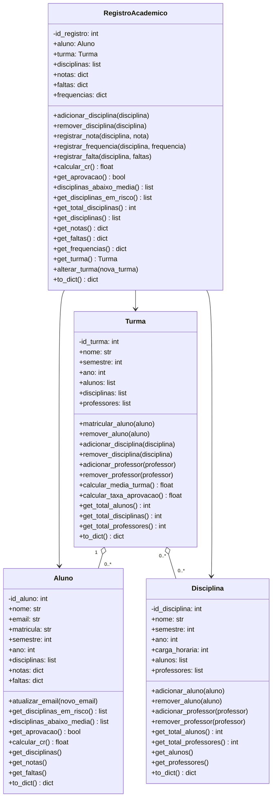
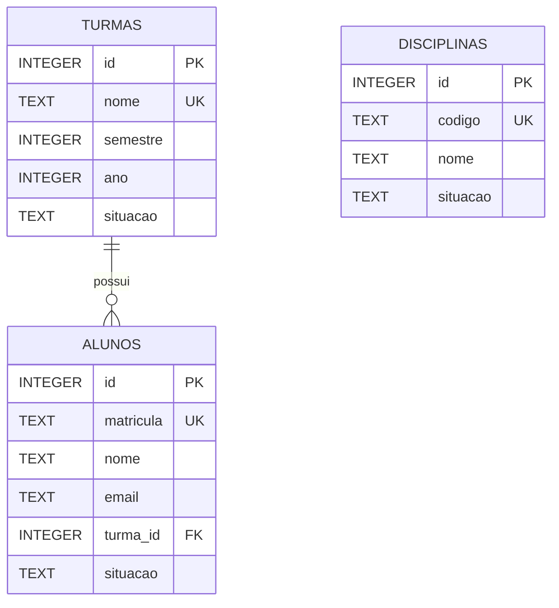
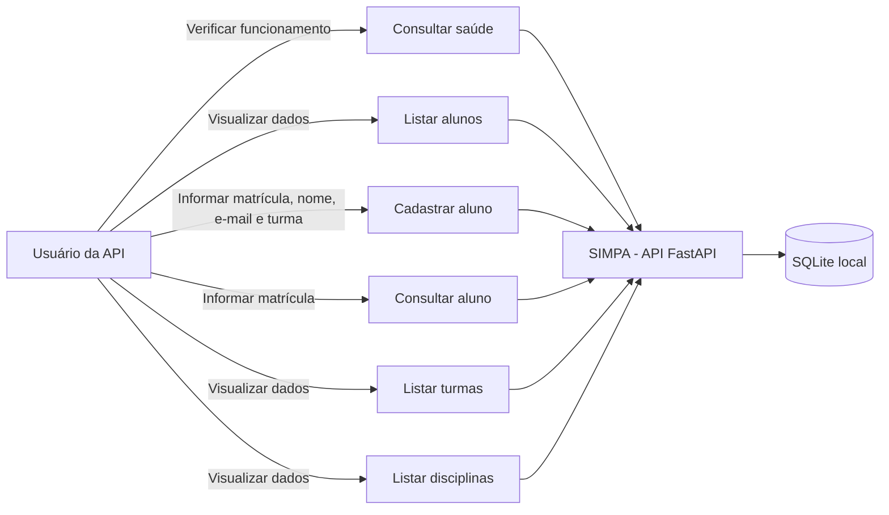

# Modelagem do SIMPA - Marco 1

Esta modelagem mostra apenas o que existe neste marco. A API usa FastAPI e SQLite. As classes acadêmicas ficam separadas da API: elas representam alunos, turmas, disciplinas e registros acadêmicos, mas as rotas atuais leem e gravam os dados diretamente pelo `RepositorioSQLite`.

## Classes acadêmicas



## API e persistência

```mermaid
classDiagram
    class API_FastAPI {
        +GET /saude
        +GET /alunos
        +POST /alunos
        +GET /alunos/{matricula}
        +GET /turmas
        +GET /disciplinas
    }

    class RepositorioSQLite {
        +inicializar()
        +listar_alunos()
        +buscar_aluno_por_matricula(matricula)
        +cadastrar_aluno(matricula, nome, email, turma_id)
        +listar_turmas()
        +listar_disciplinas()
    }

    class SQLite {
        turmas
        alunos
        disciplinas
    }

    API_FastAPI --> RepositorioSQLite
    RepositorioSQLite --> SQLite
```

O SQLite guarda três tabelas. Cada aluno pertence a uma turma por `turma_id`. Neste marco ainda não existe uma tabela para ligar turmas e disciplinas.



## Casos de uso do Marco 1



## Regras representadas

- A matrícula do aluno não pode se repetir.
- O aluno deve estar ligado a uma turma existente.
- Matrícula, nome, e-mail e turma são obrigatórios na API.
- A nota aceita pelas classes acadêmicas fica entre 0 e 10.
- A frequência aceita pelo registro acadêmico fica entre 0% e 100%.
- Turmas vazias e alunos sem notas não interrompem os cálculos.
- Os dados cadastrados pela API permanecem no arquivo SQLite após o reinício.
